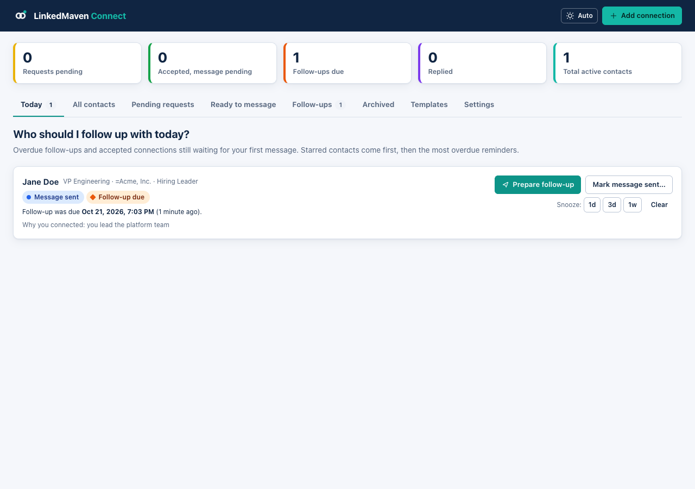
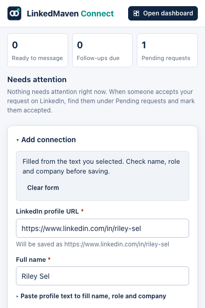
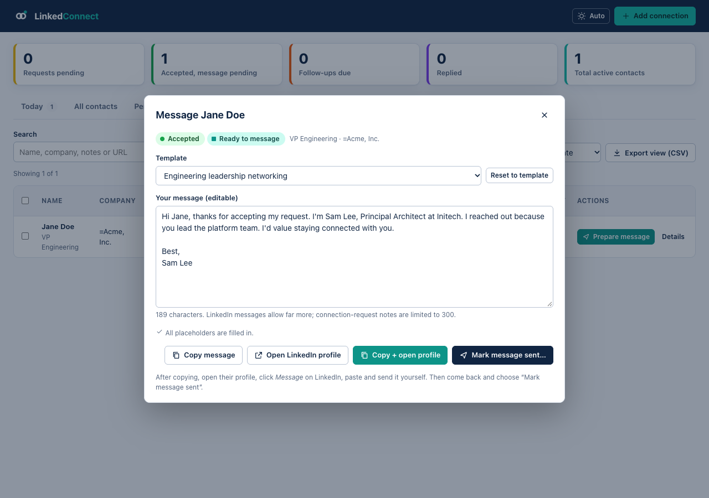
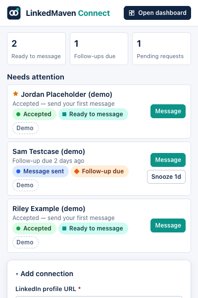
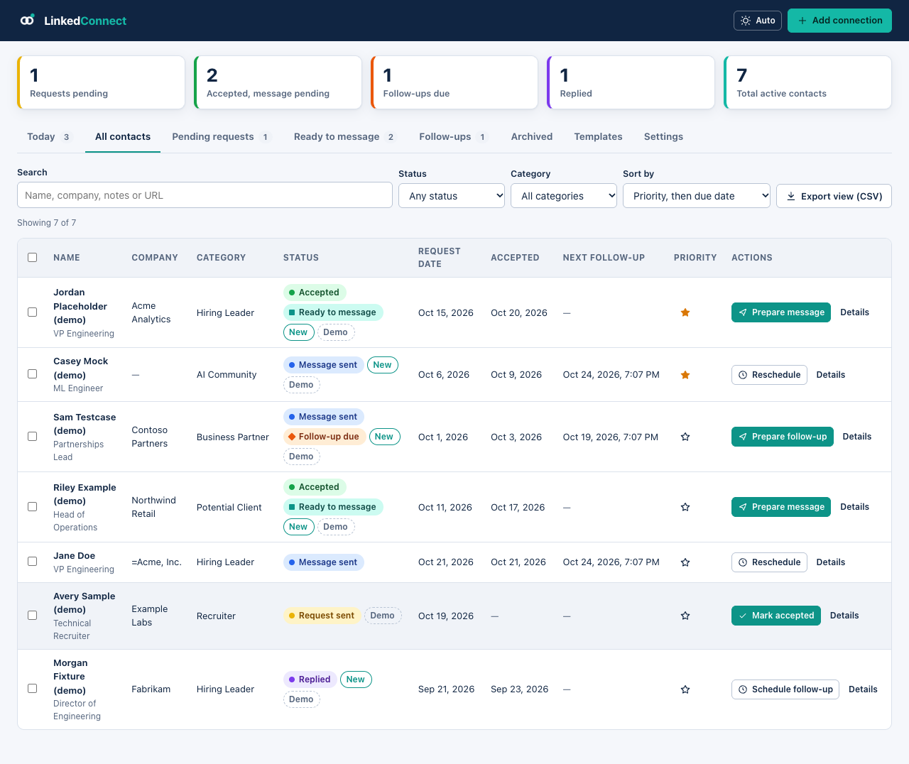
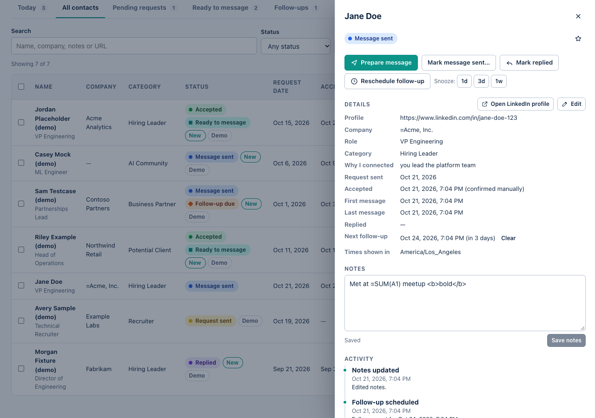
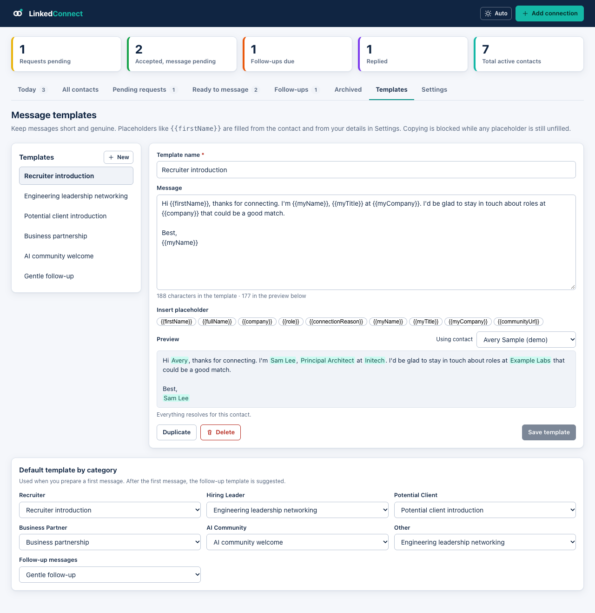
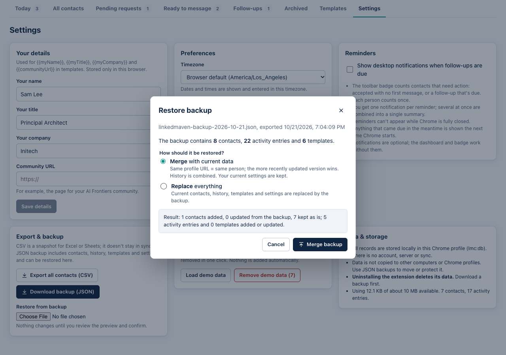
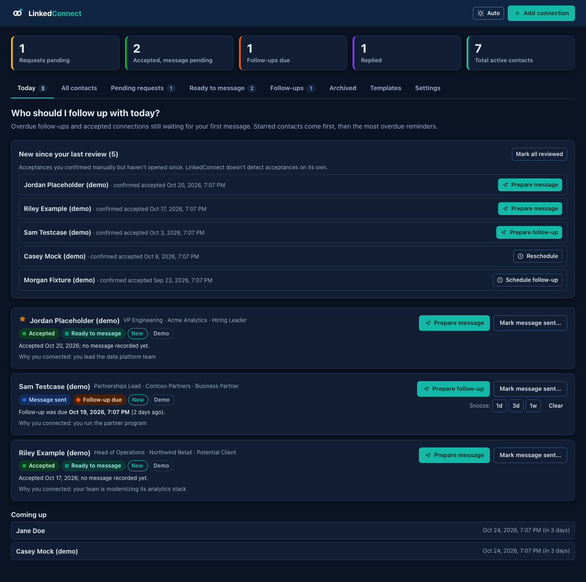

# LinkedConnect

**Track LinkedIn connection requests, see who accepted, and follow up on time.** It's a Chrome extension. Your data stays in your own browser, with no account, server or subscription.



> **What it does and doesn't do**
> - ✅ Saves each person you send a request to, with their profile link and why you connected.
> - ✅ Turns them **green** when you confirm they accepted, and puts them in your follow-up queue.
> - ✅ Prepares a personalized message from your templates for you to copy and paste.
> - ✅ Reminds you about follow-ups (dashboard, toolbar badge, optional desktop notifications).
> - ❌ Never sends invitations or messages, and never reads your LinkedIn cookies or login. On a profile it only reads the text **you highlight**, when you right-click or click the icon.
> - ❌ Can't detect acceptances on its own. **You confirm them** (see [How do I know they accepted?](#how-do-i-know-someone-accepted)).

---

## Contents

1. [Install](#1-install)
2. [Set up your details](#2-set-up-your-details-once)
3. [Add a connection](#3-add-a-connection)
4. [Confirm they accepted](#4-confirm-they-accepted)
5. [Send your first message](#5-send-your-first-message)
6. [Follow-ups and reminders](#6-follow-ups-and-reminders)
7. [Find, filter and manage contacts](#7-find-filter-and-manage-contacts)
8. [Message templates](#8-message-templates)
9. [Export to Excel and back up](#9-export-to-excel-and-back-up)
10. [Your data and privacy](#10-your-data-and-privacy)
11. [FAQ and troubleshooting](#11-faq-and-troubleshooting)

---

## 1. Install

You only need to do this once.

1. Install [Node.js](https://nodejs.org) 20 or newer.
2. In a terminal, from this folder, run:
   ```bash
   npm install
   npm run build
   ```
   This creates the `dist/` folder, which is the extension.
3. In Chrome, open **chrome://extensions**.
4. Turn on **Developer mode** (top-right).
5. Click **Load unpacked** and select the **`dist`** folder.
6. Click the puzzle-piece icon in the toolbar and **pin LinkedConnect** so its icon is always visible.

**Updating later:** run `npm run build` again, then click the ↻ reload icon on the extension's card in chrome://extensions. Your contacts are kept.

## 2. Set up your details (once)

Open the dashboard (click the toolbar icon, then **Open dashboard**) and go to **Settings → Your details**. Enter:

- **Your name**, **title** and **company**: used in messages as `{{myName}}`, `{{myTitle}}` and `{{myCompany}}`.
- **Community URL** (optional): used as `{{communityUrl}}`.

Also in Settings you can choose your **timezone**, **light or dark theme**, how many days until the **default follow-up**, and whether to turn on **desktop reminders**.

> Want to try things out first? **Settings → Load demo data** adds a few sample contacts marked "Demo". **Remove demo data** deletes them again.

## 3. Add a connection

Send your connection request on LinkedIn as usual. Then add the person in one of these ways (fastest first).

### A. Right-click on their profile (fastest)

1. On their LinkedIn profile, **highlight the top section**: drag from their name down past the headline, so the **company box** next to it (and any school or location) is included too.
2. **Right-click** and choose **LinkedConnect → Add to LinkedConnect**.
3. The popup opens with the **profile URL, name, role, company** and a **suggested category** filled in. Check them and click **Save connection**.



The company is taken from the headline ("VP Engineering **at Acme**") or, if it isn't there, from the **company box**. School, location, follower counts and "Contact info" are skipped.

**Company still missing or wrong?** Highlight just the company name, right-click, and choose **Use highlighted text as company**. It goes into the same entry you started. **Use highlighted text as role** works the same way.

**Shortcut:** highlight the top section, then click the toolbar icon instead of right-clicking. The result is the same.

You can also right-click **a link to someone's profile** anywhere on LinkedIn (search results, "More profiles") and choose **Add to LinkedConnect**.

### B. Click the toolbar icon while on their profile

The **profile URL** and **name** are filled in from the tab you're on. Type the company and role, then save.

### C. Paste

Open the popup and paste their profile URL. Optionally, copy text from their profile and paste it into **Paste profile text to fill name, role and company**.

**Good to know**

- **Switching tabs closes the popup. That's fine:** what you typed is kept and restored the next time you open it. Click **Clear form** to start over.
- Category suggestions come from the role: *recruiter/talent* → Recruiter, *VP/director/head of/manager* → Hiring Leader, *partnerships/BD* → Business Partner, *AI/ML/data* → AI Community. You can always change it.
- **Already tracking them?** You'll see "already tracked", with buttons to open the record, update it, or **Mark accepted**.
- Only real person-profile links (`linkedin.com/in/...`) are accepted. Company pages and lookalike sites are rejected.

## 4. Confirm they accepted

### How do I know someone accepted?

LinkedIn doesn't tell the extension, so check yourself. The most reliable way:

| On their profile you see | Meaning |
|---|---|
| **"1st"** next to their name and a **Message** button | ✅ Accepted |
| **"Pending"** button, "2nd"/"3rd" | ⏳ Not yet |

Other signals: a LinkedIn notification or email saying "*Name* accepted your invitation", or the person disappearing from **My Network → Manage → Sent**. Disappearing alone isn't proof, because withdrawn or expired invitations also drop off that list.

### Mark it

- In the dashboard, open **Pending requests** and click **Mark accepted**, or
- On their profile, click the toolbar icon. It shows they're already tracked; click **Mark accepted**.

Confirm the date (it defaults to now; change it if they accepted earlier). The status turns **green** and they move to **Ready to message**. New acceptances also appear under **New since your last review** on the Today page until you open them.

**Quick routine:** every day or two, go through **Pending requests**, open each profile, and mark the ones that show "1st".

## 5. Send your first message

1. Click **Prepare message** (on Today, Ready to message, or the contact's details).
2. The default template for their category is filled in with their first name and your details. **Edit the text freely.**
3. Anything missing (for example `{{company}}`) is **highlighted** and **copying is blocked** until you fill it in. You can fill it right there, and it's saved to the contact or your settings.
4. Click **Copy + open profile**. The message is copied and their LinkedIn profile opens.
5. On LinkedIn, click **Message**, paste (⌘V / Ctrl+V) and send it **yourself**.
6. Come back and click **Mark message sent…**. Optionally keep the **follow-up reminder** it offers (by default 7 days, at 9:00).



> Copying or opening the profile **never** counts as sending. Only **Mark message sent** records it, so your records stay accurate.
>
> If Chrome blocks copying, the message appears pre-selected. Just press ⌘C / Ctrl+C. Your draft is saved even if the popup closes.

## 6. Follow-ups and reminders

- **Schedule follow-up** sets a specific date and time. **Snooze** pushes it out by **1 day, 3 days or 1 week**. **Clear** removes it.
- When a follow-up is due, the contact gets an orange **Follow-up due** badge and appears on **Today**.
- **Mark replied** when they answer (purple). This clears the reminder; schedule a new one only if you want it.

**The toolbar badge** shows how many people need action: accepted but not yet messaged, or a follow-up due. Each person counts once.



**Desktop notifications** (optional): **Settings → Reminders**. Chrome asks for permission when you turn it on. You get one notification per reminder, or a single summary if several are due at once. Clicking it opens the contact.

> Reminders can't appear while Chrome is **completely closed**. Anything that came due meanwhile shows up as soon as you start Chrome again.

## 7. Find, filter and manage contacts



**Tabs:** Today · All contacts · Pending requests · Ready to message · Follow-ups · Archived · Templates · Settings.

- **Search** by name, company, notes or URL. **Filter** by status or category. **Sort** by priority, follow-up date, request date, acceptance date or name.
- ☆ **Star** important people. Starred contacts come first on Today.
- Click a name to open the **details panel**: all dates, **notes**, the **activity timeline**, and every action.
- Use the checkboxes to **archive** or **export** several at once.



**Statuses** (each badge shows a word, not just a color):

| Badge | Meaning |
|---|---|
| 🟡 **Request sent** | Waiting for them to accept |
| 🟢 **Accepted** | You confirmed they accepted |
| 🔵 **Message sent** | You recorded sending a message |
| 🟣 **Replied** | They replied |
| ⚪ **Archived** | Hidden from active lists; history kept; can be restored |
| 🟠 **Follow-up due** | A reminder's time has passed |
| **Ready to message** | Accepted, no first message yet |

**Made a mistake?** In the details panel use **Correct status…** to move someone back a step (later dates are cleared so the record stays consistent), **Edit** to fix names or dates, **Archive** to hide (keeps history), or **Delete** to remove permanently (asks first).

## 8. Message templates

**Templates** tab: create, edit, duplicate and delete templates, and preview them with any contact.



Starter templates are included: Recruiter introduction, Engineering leadership networking, Potential client introduction, Business partnership, AI community welcome, and Gentle follow-up.

**Placeholders you can use:**

| Placeholder | Filled with |
|---|---|
| `{{firstName}}` | First word of their name. To use a different one, set *First name for messages* when editing the contact |
| `{{fullName}}`, `{{company}}`, `{{role}}` | From the contact |
| `{{connectionReason}}` | Their "Why I connected" note |
| `{{myName}}`, `{{myTitle}}`, `{{myCompany}}`, `{{communityUrl}}` | From Settings → Your details |

Under **Default template by category**, choose which template each category starts with, and which one to use for follow-ups.

## 9. Export to Excel and back up

**Export to Excel (CSV)**
- **Export view (CSV)** above any list exports what you're looking at. **Settings → Export all contacts (CSV)** exports everything.
- The file is named `linkedconnect-connections-YYYY-MM-DD.csv` and opens cleanly in Excel (accents, commas and line breaks intact).
- It's a snapshot. It doesn't stay in sync with Excel.

**Backup and restore (JSON)**
- **Settings → Download backup (JSON)** saves everything: contacts, history, templates and settings.
- **Restore from backup** shows a preview first. Then choose:
  - **Merge:** adds what's missing; for people in both, the more recently updated record wins. Your current settings are kept.
  - **Replace:** replaces everything with the backup (needs an extra confirmation).
- Damaged or unrelated files are rejected and nothing is changed.



## 10. Your data and privacy

- Everything is stored **only in this Chrome profile** on this computer. It isn't synced to other computers or profiles.
- **Uninstalling the extension deletes its data.** Download a backup regularly, and always before uninstalling.
- Permissions, and why:
  - **Storage** and **alarms**: save your records and schedule reminders.
  - **activeTab** and **scripting**: when you click the icon or a right-click option, read that tab's address and title and **only the text you highlighted** (with its line breaks, so name, headline and company can be told apart). Nothing else on the page is read.
  - **contextMenus**: the right-click options.
  - **Notifications** (optional, asked only if you turn on desktop reminders).
- No access to other websites, the rest of the LinkedIn page, cookies or browsing history. Nothing is sent anywhere.

## 11. FAQ and troubleshooting

**The company didn't fill in.** Make sure your highlight includes the company box next to the headline. If it still misses, highlight just the company name and right-click → **Use highlighted text as company**.

**The popup closed when I switched tabs.** Chrome does this to every extension popup. Reopen it; what you typed is restored.

**The right-click option doesn't appear.** It only shows on linkedin.com pages. Make sure the extension is enabled and up to date in chrome://extensions.

**Right-click opened the dashboard instead of the popup.** Your Chrome version can't open the popup from a menu; the dashboard's Add form has the same details filled in.

**Copy is greyed out.** A placeholder is still missing. Fill in the highlighted field above the buttons, or edit the text.

**I didn't get a desktop notification.** Check Settings → Reminders is on and that macOS/Windows allows Chrome notifications. The dashboard and badge work either way.

**Dark mode?** Click the theme button (Auto / Dark / Light) at the top of the dashboard.



---

For architecture, tests and the full acceptance checklist, see [docs/DEVELOPMENT.md](docs/DEVELOPMENT.md).
